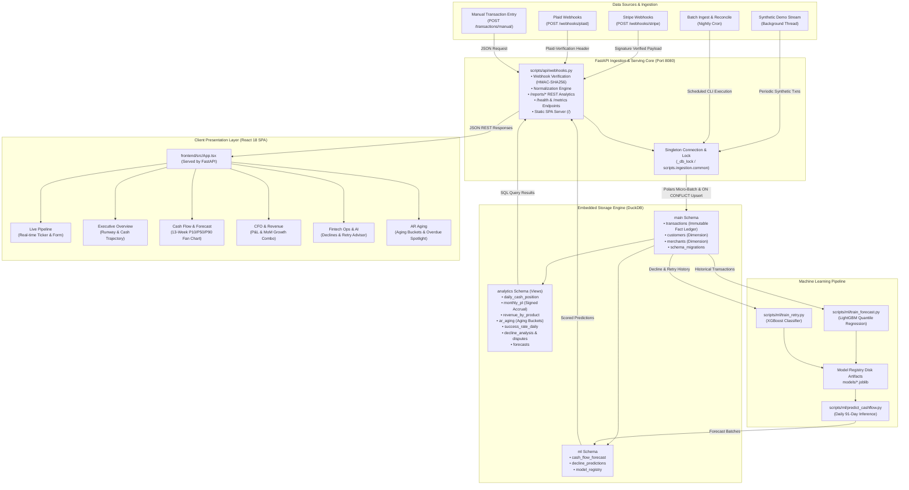

# LedgerFlow — System Architecture & Specification (SPEC.md)

> **Document Version:** 1.0.0  
> **Status:** Active / Living Specification  
> **Target System:** Financial Observability, Payment Operations, and Cash Forecasting Platform  

---

## 1. System Overview & Problem Statement

**LedgerFlow** is a modern financial observability platform designed for high-growth tech companies and fintech operations teams. It unifies transaction data from disparate payment processors (Stripe) and banking networks (Plaid) into a single, high-performance embedded OLAP ledger powered by **DuckDB** and **Polars**.

### Core Problem Solved
Modern finance, treasury, and payment engineering teams face severe operational fragmentation:
1. **Siloed Ingestion:** Webhooks, credit card authorizations, ACH transfers, wire payouts, and processor fees originate from incompatible data streams with distinct schemas and settlement cadences.
2. **Delayed Cash Visibility:** Traditional ERPs update on multi-day accrual schedules, leaving controllers and treasurers without real-time cash position and runway visibility.
3. **Reactive Decline Management:** Involuntary churn from failed recurring credit card payments is managed with dumb exponential backoff rather than intelligent, feature-driven retry timing.
4. **Heavyweight Infrastructure Overhead:** Traditional BI setups require dedicated data warehouses (Snowflake/BigQuery) and ETL orchestration tools (Airflow) that are expensive and slow to iterate on for mid-market teams.

### Solution Architecture
LedgerFlow solves these challenges via:
* **Single-Container Hybrid Architecture:** Serves both a real-time FastAPI ingestion/webhook engine and a compiled React 18 / TypeScript single-page application (SPA) from the same origin.
* **Embedded Columnar Storage:** Leverages in-process DuckDB with zero external database server dependency for local development, while supporting PostgreSQL for multi-tenant production scaling.
* **Deterministic Accounting Integrity:** Standardized double-entry signed accounting rules across cash and accrual bases, with automated nightly payout reconciliation.
* **Embedded Machine Learning:** LightGBM quantile regression ($P_{10}, P_{50}, P_{90}$) for 13-week cash forecasting and XGBoost binary classification for payment decline-retry recovery.

---

## 2. Existing Technology Stack

```
┌──────────────────────────────────────────────────────────────────────────────┐
│                                TECH STACK SUMMARY                            │
├──────────────────────┬───────────────────────────────────────────────────────┤
│ Language Runtimes    │ Python 3.11+ (CPython) · Node.js 20+ (LTS)            │
│ Web & API Framework  │ FastAPI (0.109+) · Uvicorn (0.27+) · Pydantic v2 (2.6+)│
│ Data Processing & DB │ DuckDB (1.0+) · Polars (1.0+) · PyArrow (15.0+)       │
│ Machine Learning     │ LightGBM (4.3+) · XGBoost (2.1+) · Scikit-Learn · Joblib│
│ Frontend SPA         │ React 18.3 · TypeScript 5.5 · Vite 5.4 · Chart.js 4.4 │
│ Financial SDKs       │ Stripe Python SDK (8.0+) · Plaid Python SDK (16.0+)  │
│ Tooling & Package Mgr│ Astral uv (Python) · npm (Frontend) · Ruff · Mypy     │
│ Testing Frameworks   │ Pytest 8 · Pytest-Cov · Hypothesis · Vitest 2.0       │
│ Container & Hosting  │ Docker (Multi-Stage) · Fly.io · Render · Linux Cron   │
└──────────────────────┴───────────────────────────────────────────────────────┘
```

### 2.1 Backend Core & Ingestion
* **Python 3.11+**: Primary runtime for data ingestion, database management, analytical queries, and machine learning inference.
* **FastAPI & Uvicorn**: High-concurrency ASGI web framework powering real-time webhooks, REST analytical endpoints, and static SPA serving.
* **Pydantic v2**: Strict schema definition and request validation for manual transaction inputs and webhook payloads.
* **Polars & PyArrow**: In-memory vectorized DataFrame transformations ensuring sub-millisecond data shaping before loading into DuckDB.
* **DuckDB**: Columnar OLAP engine functioning as an embedded database (`data/ledgerflow.duckdb`) providing analytical window functions, temporal aggregations, and sub-second SQL queries over tens of thousands of transactions.
* **Stripe SDK & Plaid SDK**: Official API clients for pulling payment gateway events and bank transaction feeds.

### 2.2 Machine Learning Engine
* **LightGBM**: Quantile regression gradient-boosted decision trees trained to output multi-horizon ($P_{10}$, $P_{50}$, $P_{90}$) cash trajectory intervals, capturing asymmetric downside financial risk.
* **XGBoost**: Gradient boosting binary classifier scoring declined transactions to predict successful recovery within 7 days and recommend an optimal retry policy (`retry_1h`, `retry_24h`, `retry_72h`, `do_not_retry`).
* **Scikit-Learn & Joblib**: Model evaluation pipelines (Pinball loss, MAE, ROC-AUC, PR-AUC) and artifact serialization to disk (`models/*.joblib`).

### 2.3 Frontend Dashboard & Presentation
* **React 18.3 (SPA)**: Component-driven user interface architected around functional components and custom React hooks for reactive state management.
* **TypeScript 5.5**: End-to-end type safety for API responses, data structures, and Chart.js options.
* **Vite 5.4**: Fast ES module bundler configuring development proxying to port 8080 and optimized production static assets outputting to `frontend/dist/`.
* **Chart.js 4.4**: Canvas-based data visualization library rendering multi-dataset bar charts, fan charts, donut charts, and combo growth plots.
* **Modular CSS**: Custom CSS theme tokens (`frontend/src/styles/theme.css`) with consistent financial tabular typography (`tabular-nums`), badges, and status colors.

### 2.4 Developer Tools & Quality Assurance
* **Astral uv**: Fast Python package manager and script runner replacing pip/virtualenv.
* **Ruff**: Fast Python linter and code formatter targeting Python 3.11 rules.
* **Mypy**: Static type checker running across backend scripts and ingestion utilities.
* **Pytest & Vitest**: Dual-test harness covering backend unit/integration tests and frontend React component/hook tests.
* **Faker**: Synthetic demographic and transaction generator modeling 50,000+ realistic SaaS transactions.

### 2.5 Infrastructure & Deployment
* **Docker Multi-Stage Build**:
  - *Stage 0 (`frontend-builder`)*: Node 20 environment building the TypeScript/React application to `dist/`.
  - *Stage 1 (`python-builder`)*: Python 3.11 environment installing pre-compiled binary wheels with `uv`.
  - *Stage 2 (`runtime`)*: Minimal Debian Slim image running non-root `ledgerflow` user with cron daemon and FastAPI.
* **Fly.io (`fly.toml`)**: Primary production platform with dedicated persistent volume mounts (`/data` for DuckDB and `/models` for ML joblib files) and rolling deployment health checks.
* **Render (`render.yaml`)**: Alternative container deployment specification supporting dynamic `PORT` configuration.

---

## 3. System Architecture & Component Interactions

### 3.1 Architectural Topology



---

### 3.2 Subsystem Deep-Dive

#### 1. Ingestion & In-Memory Concurrency Subsystem
* **File:** `scripts/ingestion/common.py`
* **Concurrency Model:** DuckDB utilizes an exclusive file lock for write operations. To allow concurrent webhook processing, background demo generation, and user manual transactions without lock contention errors (`duckdb.IOException: Could not set lock on file`), LedgerFlow implements an in-process singleton connection cache and reentrant mutex `_db_lock`.
* **Polars Staging:** Incoming transaction dictionaries are cleaned, stripped of auto-generated column names (`amount_usd`, `net_amount_usd`, `fee_amount_usd`), cast to strongly typed Polars DataFrames with explicit temporal and numeric types, and registered in DuckDB as `staging_txns` before executing an `ON CONFLICT (transaction_id) DO UPDATE` query.

#### 2. Signed Accounting & Normalization Model
* **Conventions Defined:** `data/seed_docs.md`
* LedgerFlow enforces double-entry arithmetic consistency:
  $$\text{net\_amount} = \begin{cases} 
  \text{amount} - \text{fee\_amount} & \text{if type} = \text{'charge'} \land \text{status} = \text{'succeeded'} \\
  -|\text{amount}| & \text{if type} \in \{\text{'refund'}, \text{'payout'}, \text{'fee'}\} \\
  \pm \text{amount} & \text{if type} = \text{'transfer'} \text{ (dependent on inflow/outflow direction)}
  \end{cases}$$
* **Temporal Partitioning Columns:** Because DuckDB does not compute table partition keys via triggers, `scripts/ingestion/common.py:_date_fields()` automatically generates `occurred_date`, `posted_date`, `occurred_hour`, `occurred_dow`, `occurred_week`, `occurred_month`, `occurred_quarter`, and `occurred_year` for all entries.

#### 3. Database Schema Architecture
* **File:** `scripts/db/init_db.py`, `scripts/db/migrate.py`
* The database encapsulates three dedicated schemas:
  * **`main`**: Contains the raw, immutable ledger (`transactions`), customer records (`customers`), merchant definitions (`merchants`), and migration audit table (`schema_migrations`).
  * **`analytics`**: Seven pre-aggregated views powering dashboard reports:
    - `analytics.daily_cash_position`: Rolling cash inflows, outflows, net flow, and unbounded cumulative running balance.
    - `analytics.monthly_pl`: Accrual P&L categorized by general ledger `account_code`.
    - `analytics.revenue_by_product`: Sliced across 5 product lines (`subscriptions`, `professional_services`, `marketplace`, `ecommerce`, `platform_fees`).
    - `analytics.ar_aging`: Customer invoice aging split into 4 standard accounting buckets ($0\text{--}30\text{d}$, $31\text{--}60\text{d}$, $61\text{--}90\text{d}$, $90+\text{d}$).
    - `analytics.success_rate_daily`: Authorization performance by gateway source.
    - `analytics.decline_analysis`: Categorization of card decline reason codes.
    - `analytics.disputes`: Tracked disputes with automatic 30-day evidence deadlines (`due_by`).
  * **`ml`**: Stores multi-quantile forecast horizons (`ml.cash_flow_forecast`), transaction-level decline recommendations (`ml.decline_predictions`), and model registry metadata (`ml.model_registry`).

#### 4. Machine Learning Subsystem
* **Cash Flow Quantile Regression (`scripts/ml/train_forecast.py`):**
  - Trains three distinct LightGBM quantile regression models ($\alpha \in [0.10, 0.50, 0.90]$).
  - Target: Next day net cash flow ($y = \text{net\_flow\_usd}_{t+1}$).
  - Features: Calendar harmonics, weekend indicators, day-of-month flags, lagged net flows ($1, 2, 3, 7, 14, 30$ days), rolling means/standard deviations ($7, 30$ days), and cumulative cash trajectory.
  - Evaluation Metric: Pinball loss (`mean_pinball_loss`) and MAE.
* **Decline Retry Policy Classifier (`scripts/ml/train_retry.py`):**
  - Trains an XGBoost binary classification model to predict whether a failed transaction will settle upon retry within 7 days ($y \in \{0, 1\}$).
  - Features: Categorical decline code indices, card brand, card funding type (credit, debit, prepaid), transaction amount, hour of occurrence, and historical customer retry counts.
  - Policy Assignment:
    - $P(\text{recovery}) \ge 0.70 \implies \texttt{retry\_1h}$
    - $0.40 \le P(\text{recovery}) < 0.70 \implies \texttt{retry\_24h}$
    - $0.20 \le P(\text{recovery}) < 0.40 \implies \texttt{retry\_72h}$
    - $P(\text{recovery}) < 0.20 \implies \texttt{do\_not\_retry}$
* **Inference Pipeline (`scripts/ml/predict_cashflow.py`):**
  - Runs daily via cron, recursive multi-step forecasting across a 91-day (13-week) horizon, generating $P_{10}$, $P_{50}$, and $P_{90}$ daily and cumulative cash positions.

#### 5. Web API & Dashboard Controller
* **File:** `scripts/api/webhooks.py`
* Exposes 10 core HTTP endpoints:
  - `GET /`: Serves the compiled React SPA from `frontend/dist/index.html` with explicit `Cache-Control: no-store` headers.
  - `POST /webhooks/stripe`: Validates Stripe HMAC signatures, normalizes charge/refund/payout events, and queues asynchronous background ingestion.
  - `POST /webhooks/plaid`: Validates Plaid verification headers and triggers transaction sync or removal tasks.
  - `POST /transactions/manual`: Accepts custom manual entries for operational testing and ad-hoc ledger adjustments.
  - `GET /transactions/recent`: Returns the 20 most recent transactions for the real-time pipeline feed.
  - `GET /stats/live`: Aggregated summary statistics (volume, USD value, success rate, source breakdown).
  - `GET /reports/executive`: 30-day historical cash trends, current liquidity, and runway calculations.
  - `GET /reports/cashflow`: 13-week ML forecast fan chart data and 12-week historical cash movements.
  - `GET /reports/revenue`: Monthly P&L breakdowns and product-line revenue distributions.
  - `GET /reports/ops`: Gateway success rate time series, top decline reasons, and AI retry advice.
  - `GET /reports/ar-aging`: Receivables outstanding across aged customer buckets.
  - `GET /health` & `GET /metrics`: Container orchestrator liveness/readiness probes and throughput metrics.

---

## 4. Complete Project File Structure

```
d:/LedgerFlow/
│
├── .github/
│   └── workflows/
│       └── ci.yml                      # GitHub Actions: Python (ruff/mypy/pytest) + Frontend (tsc/vitest/build)
│
├── docker/                             # Containerization and cron orchestration
│   ├── Dockerfile                      # Multi-stage image: Node builder -> Python builder -> Runtime
│   ├── docker-entrypoint.sh            # Container bootstrapper: schema init, seed generator, cron daemon, uvicorn
│   └── crontab                         # Scheduled tasks: nightly Stripe/Plaid sync, reconciliation, weekly ML retrain
│
├── frontend/                           # React 18 + TypeScript + Vite Single Page Application
│   ├── dist/                           # Compiled production static bundle (served by FastAPI at /)
│   ├── node_modules/                   # Node dependencies (gitignored)
│   ├── src/
│   │   ├── components/                 # Reusable UI widgets
│   │   │   └── charts/
│   │   │       └── ChartBox.tsx        # Standardized Chart.js wrapper with responsive container
│   │   ├── features/                   # Feature-based architecture matching 6 dashboard views
│   │   │   ├── ar-aging/               # Tab 6: Accounts Receivable Aging
│   │   │   │   ├── ArAgingTab.tsx      # Main tab view layout
│   │   │   │   ├── ArAgingTable.tsx    # Customer receivables data table with severity badges
│   │   │   │   ├── ArBucketChart.tsx   # Aging bucket distribution donut chart
│   │   │   │   ├── ArKpiStrip.tsx      # Top-level KPI metrics cards
│   │   │   │   ├── OverdueSpotlight.tsx# Top high-risk overdue customer highlight cards
│   │   │   │   ├── useArAging.ts       # React query hook fetching /reports/ar-aging
│   │   │   │   └── __tests__/          # Vitest suite for AR aging hooks
│   │   │   ├── cashflow/               # Tab 3: Cash Flow & 13-Week Forecast
│   │   │   │   ├── CashflowTab.tsx     # Main tab view layout
│   │   │   │   ├── CashflowKpiStrip.tsx# Forecast summary KPI strip
│   │   │   │   ├── ForecastFanChart.tsx# Multi-quantile (P10/P50/P90) forecast projection chart
│   │   │   │   ├── WeeklyFlowChart.tsx # Historical weekly net flow bar chart
│   │   │   │   ├── WeeklyFlowTable.tsx # Tabular weekly cash movements
│   │   │   │   ├── useCashflow.ts      # Data fetching hook for /reports/cashflow
│   │   │   │   └── __tests__/          # Vitest suite for cashflow hooks
│   │   │   ├── executive/              # Tab 2: Executive Overview
│   │   │   │   ├── ExecutiveTab.tsx    # Main tab view layout
│   │   │   │   ├── ExecutiveKpiStrip.tsx# High-level metrics: runway, cash balance, burn rate
│   │   │   │   ├── CashTrajectoryChart.tsx# 30-day cumulative cash balance line chart
│   │   │   │   ├── DailyFlowsChart.tsx # Daily gross inflows vs. outflows bar chart
│   │   │   │   ├── ExecutiveFlowsTable.tsx# Daily cash movement audit table
│   │   │   │   ├── useExecutive.ts     # Data fetching hook for /reports/executive
│   │   │   │   └── __tests__/          # Vitest suite for executive hooks
│   │   │   ├── live-pipeline/          # Tab 1: Live Real-Time Pipeline
│   │   │   │   ├── LivePipelineTab.tsx # Main tab view layout
│   │   │   │   ├── LiveKpiStrip.tsx    # Real-time transaction stats strip
│   │   │   │   ├── ManualTransactionForm.tsx # Direct ledger entry submission form
│   │   │   │   ├── SourceDistributionCard.tsx# Gateway source volume breakdown
│   │   │   │   ├── TransactionStreamCard.tsx # Auto-refreshing recent transaction stream
│   │   │   │   ├── useLivePipeline.ts  # Polling hook fetching /transactions/recent & /stats/live
│   │   │   │   └── __tests__/          # Vitest suite for live pipeline hooks
│   │   │   ├── ops/                    # Tab 5: Fintech Operations & AI Retry Advisor
│   │   │   │   ├── OpsTab.tsx          # Main tab view layout
│   │   │   │   ├── OpsKpiStrip.tsx     # Gateway authorization KPI metrics
│   │   │   │   ├── DeclinesChart.tsx   # Top decline codes breakdown bar chart
│   │   │   │   ├── DisputesTable.tsx   # Active chargeback disputes and deadlines table
│   │   │   │   ├── RetryAdvisorTable.tsx# Scored ML recommendations with recovery actions
│   │   │   │   ├── SuccessTrendChart.tsx# Gateway success rate trend over time
│   │   │   │   ├── useOps.ts           # Data fetching hook for /reports/ops
│   │   │   │   └── __tests__/          # Vitest suite for ops hooks
│   │   │   └── revenue/                # Tab 4: CFO & Revenue Breakdown
│   │   │       ├── RevenueTab.tsx      # Main tab view layout
│   │   │       ├── RevenueKpiStrip.tsx # ARR/MRR and MoM growth metrics
│   │   │       ├── IncomeStatementTable.tsx # General ledger P&L by account code
│   │   │       ├── RevenueGrowthCombo.tsx# Revenue bars with overlay MoM growth line
│   │   │       ├── RevenueMixChart.tsx # Product line share donut chart
│   │   │       ├── RevenueProductBars.tsx# Stacked product line revenue history
│   │   │       ├── useRevenue.ts       # Data fetching hook for /reports/revenue
│   │   │       └── __tests__/          # Vitest suite for revenue hooks
│   │   ├── lib/                        # Shared utility libraries
│   │   │   ├── api.ts                  # Formatter utilities (fmt_usd, timeAgo, chart themes)
│   │   │   ├── tabs.ts                 # Tab identifiers, navigation labels, and metadata
│   │   │   └── __tests__/              # Unit tests for lib utilities
│   │   ├── styles/
│   │   │   └── theme.css               # Design system tokens, layout grid, typography, cards
│   │   ├── App.tsx                     # Top-level shell: header, navigation bar, tab switching
│   │   └── main.tsx                    # React DOM entry point
│   ├── package.json                    # Frontend dependencies and npm scripts
│   ├── tsconfig.json                   # TypeScript configuration
│   └── vite.config.ts                  # Vite build settings & dev proxy config to port 8080
│
├── scripts/                            # Core Python backend engine
│   ├── __init__.py
│   ├── api/                            # API and HTTP delivery layer
│   │   ├── __init__.py
│   │   ├── webhooks.py                 # Primary FastAPI service (routes, webhooks, analytics, static files)
│   │   └── live_input.html             # Legacy standalone fallback dashboard (served at /legacy)
│   ├── db/                             # Database lifecycle management
│   │   ├── __init__.py
│   │   ├── init_db.py                  # DDL script initializing DuckDB schemas, tables, and views
│   │   └── migrate.py                  # Versioned schema migration runner
│   ├── ingestion/                      # Data ingestion and reconciliation engines
│   │   ├── __init__.py
│   │   ├── common.py                   # Shared normalizers, date generators, and thread-safe upserts
│   │   ├── ingest_stripe.py            # Batch Stripe API sync script
│   │   ├── ingest_plaid.py             # Batch Plaid bank feed sync script
│   │   └── reconcile.py                # Nightly reconciliation: Stripe payouts vs. Plaid deposits
│   ├── ml/                             # Predictive modeling subsystem
│   │   ├── __init__.py
│   │   ├── train_forecast.py           # LightGBM multi-quantile cash flow training
│   │   ├── train_retry.py              # XGBoost decline recovery advisor training
│   │   └── predict_cashflow.py         # Batch inference generating 13-week forecast tables
│   └── utils/                          # Operational and developer utilities
│       ├── __init__.py
│       ├── generate_synthetic.py       # High-fidelity synthetic transaction generator (50k+ rows)
│       └── health_check.py             # Deep readiness/liveness audit script
│
├── tests/                              # Comprehensive test harness
│   ├── integration/
│   │   └── __init__.py                 # End-to-end integration tests
│   └── unit/
│       ├── test_generate_synthetic.py  # Validation of synthetic generator logic and distributions
│       ├── test_live_input.py          # API route tests, normalizer logic, and signed accounting
│       ├── test_ml.py                  # Quantile training and prediction pipeline verification
│       └── test_schema.py              # DuckDB DDL integrity and analytics view assertions
│
├── data/                               # Local persistent storage (gitignored)
│   ├── ledgerflow.duckdb               # DuckDB persistent columnar database
│   ├── ledgerflow.duckdb.wal           # Write-Ahead Log
│   ├── seed_docs.md                    # Data dictionary, signed conventions, and generator specs
│   └── transactions/                   # Cold storage partition directory (Parquet format)
│
├── models/                             # Trained model bundle registry (gitignored)
│   ├── cash_forecast.joblib            # Serialized LightGBM quantile regression bundle
│   └── decline_retry.joblib            # Serialized XGBoost classification bundle
│
├── .env.example                        # Reference environment configuration
├── .gitignore                          # Git file exclusion rules
├── .gitattributes                      # Git LFS and line-ending configurations
├── docker-compose.yml                  # Local development container specification
├── fly.toml                            # Fly.io production deployment manifest
├── render.yaml                         # Render container deployment blueprint
├── pyproject.toml                      # Python package configuration, dependencies, and tool settings
├── uv.lock                             # Pinned reproducible dependency lockfile
├── Makefile                            # Developer command runner (build, test, dev, deploy)
├── README.md                           # Project introduction and quickstart guide
├── TODO.md                             # Active engineering task backlog and rhythm log
└── SPEC.md                             # System specification and architecture living document
```

---

## 5. Operational Model & Environment Configuration

### 5.1 Environment Configuration Reference

The application dynamically detects configuration through environment variables (defined in `.env.example`):

| Variable | Scope | Default | Description |
| :--- | :--- | :--- | :--- |
| `DUCKDB_PATH` | Local / Dev | `data/ledgerflow.duckdb` | Path to persistent DuckDB database file |
| `DATABASE_URL` | Prod (Optional) | `None` | PostgreSQL connection string for multi-tenant deployments |
| `MODEL_REGISTRY_PATH` | All | `models/` | Directory storing trained `.joblib` model bundles |
| `WEBHOOK_PORT` | Local / Fly | `8080` | Internal port the FastAPI service listens on |
| `PORT` | Render / Cloud | `${WEBHOOK_PORT}` | Injected dynamically by Render / Cloud PaaS |
| `DEMO_MODE` | Dev | `true` | When true, spawns a background thread inserting synthetic events |
| `DEMO_INTERVAL_SEC` | Dev | `4` | Cadence (in seconds) between streaming demo transactions |
| `GENERATE_SYNTHETIC` | Dev / Docker | `true` | When true on initial startup, automatically seeds 50k transactions |
| `STRIPE_SECRET_KEY` | Production | `None` | Stripe API Secret Key (`sk_live_...` or `sk_test_...`) |
| `STRIPE_WEBHOOK_SECRET`| Production | `None` | Stripe endpoint secret (`whsec_...`) for HMAC verification |
| `STRIPE_ACCOUNT_ID` | Production | `acct_default` | Connect merchant account identifier |
| `PLAID_CLIENT_ID` | Production | `None` | Plaid API Client ID |
| `PLAID_SECRET` | Production | `None` | Plaid API Secret |
| `PLAID_ENV` | Production | `sandbox` | Plaid environment tier (`sandbox`, `development`, `production`) |
| `PLAID_ACCESS_TOKENS` | Production | `None` | Comma-separated list of active Plaid Item access tokens |
| `SENTRY_DSN` | Production | `None` | Optional Sentry DSN for exception tracking |
| `SLACK_WEBHOOK_URL` | Production | `None` | Operational alerts webhook for reconciliation discrepancies |
| `LOG_LEVEL` | All | `INFO` | Logging verbosity (`DEBUG`, `INFO`, `WARNING`, `ERROR`) |

---

### 5.2 Container Lifecycle & Execution Model

The container bootstrapper (`docker/docker-entrypoint.sh`) executes deterministically on start:
1. **Directory Preparation:** Creates `/data`, `/models`, and `/var/log/ledgerflow`.
2. **Model Hydration:** Copies baked fallback pre-trained `.joblib` models from `/app/models/` to the persistent `/models/` volume if missing.
3. **Database Initialization & Migration:**
   - If `/data/ledgerflow.duckdb` is absent: executes `scripts/db/init_db.py` and seeds lightweight demonstration transactions.
   - If `/data/ledgerflow.duckdb` is present: executes `scripts/db/migrate.py` to apply pending schema migrations.
4. **Initial Forecasting Run:** Runs `scripts/ml/predict_cashflow.py` non-blockingly to generate initial 91-day projections.
5. **Daemon Activation:** Starts the Linux `cron` daemon for scheduled background maintenance.
6. **Web Server Handoff:** Executes Uvicorn via `exec python -m uvicorn scripts.api.webhooks:app --host 0.0.0.0 --port ${PORT:-8080}` as PID 1.

---

### 5.3 Automated Cron Schedule (`docker/crontab`)

All scheduled tasks run inside the container as the non-root `ledgerflow` user with UTC timestamps:

```cron
# Nightly at 02:30 UTC: Ingest incremental Stripe events
30 2 * * * /usr/local/bin/python /app/scripts/ingestion/ingest_stripe.py --db /data/ledgerflow.duckdb >> /var/log/ledgerflow/ingest_stripe.log 2>&1

# Nightly at 02:35 UTC: Ingest incremental Plaid bank transactions
35 2 * * * /usr/local/bin/python /app/scripts/ingestion/ingest_plaid.py --db /data/ledgerflow.duckdb >> /var/log/ledgerflow/ingest_plaid.log 2>&1

# Nightly at 03:00 UTC: Reconcile Stripe payouts against Plaid bank deposits
0 3 * * * /usr/local/bin/python /app/scripts/ingestion/reconcile.py --db /data/ledgerflow.duckdb >> /var/log/ledgerflow/reconcile.log 2>&1

# Weekly on Sunday at 03:30 UTC: Retrain LightGBM cash flow forecast model
30 3 * * 0 /usr/local/bin/python /app/scripts/ml/train_forecast.py --db /data/ledgerflow.duckdb --output /models/cash_forecast.joblib >> /var/log/ledgerflow/train_forecast.log 2>&1

# Weekly on Sunday at 03:45 UTC: Retrain XGBoost decline retry model
45 3 * * 0 /usr/local/bin/python /app/scripts/ml/train_retry.py --db /data/ledgerflow.duckdb --output /models/decline_retry.joblib >> /var/log/ledgerflow/train_retry.log 2>&1

# Daily at 06:00 UTC: Generate fresh 91-day cash flow forecast predictions
0 6 * * * /usr/local/bin/python /app/scripts/ml/predict_cashflow.py --db /data/ledgerflow.duckdb --model /models/cash_forecast.joblib >> /var/log/ledgerflow/predict_cashflow.log 2>&1

# Every 15 minutes: Run health verification and schema integrity probe
*/15 * * * * /usr/local/bin/python /app/scripts/utils/health_check.py --db /data/ledgerflow.duckdb >> /var/log/ledgerflow/health.log 2>&1
```

---

### 5.4 Makefile Workflow Cheat Sheet

| Command | Category | Action |
| :--- | :--- | :--- |
| `make dev` | Dev | Bootstraps `.env`, seeds DuckDB (5k rows), and runs FastAPI on `:8080` with auto-reload |
| `make web` | Frontend | Launches Vite dev server on `:5173` with local API proxying to `:8080` |
| `make web-build` | Frontend | Runs TypeScript build (`tsc -b`) and bundles assets into `frontend/dist/` |
| `make web-test` | Frontend | Executes frontend Vitest unit test suite |
| `make seed` | Data | Generates 50,000 realistic synthetic transactions into `data/ledgerflow.duckdb` |
| `make train` | ML | Trains both the LightGBM forecast and XGBoost retry models to `models/` |
| `make test` | Quality | Executes the full test matrix (Python `pytest` + Frontend `vitest`) |
| `make lint` | Quality | Runs `ruff check` and `ruff format --check` across scripts and tests |
| `make typecheck`| Quality | Executes `mypy` static type checking across all backend modules |
| `make build` | Docker | Assembles multi-stage Docker production image tagged `ledgerflow:latest` |
| `make deploy` | Cloud | Triggers Fly.io production deployment using `fly.toml` |

---

## 6. Current Implementation Status & Roadmap

### 6.1 Completed Capabilities
- [x] Multi-source transaction ingestion pipeline supporting Stripe webhooks, Plaid feeds, and manual entries.
- [x] Embedded DuckDB analytical database architecture with complete DDL, index tuning, and view materialization.
- [x] Concurrency control avoiding DuckDB single-writer locks via `threading.Lock` and singleton connection caching.
- [x] Signed double-entry accounting model handling gross fees, negative disbursements, and refund offsets.
- [x] Full LightGBM multi-quantile regression cash flow modeling with recursive multi-day prediction intervals.
- [x] Full XGBoost decline-retry policy classifier predicting 7-day payment recovery likelihood.
- [x] Modern, responsive React 18 + TypeScript SPA with 6 fully functional BI tabs:
  - *Live Pipeline:* Stream ticker, volume aggregates, manual entry form.
  - *Executive Overview:* Cash runway, daily inflow/outflow charts, 30-day trajectory.
  - *Cash Flow & Forecast:* 13-week $P_{10}/P_{50}/P_{90}$ fan chart and weekly historical movements.
  - *CFO & Revenue:* P&L income statement, MoM growth combo, and product mix donut chart.
  - *Fintech Ops & AI:* Gateway authorization trends, top decline codes, AI retry advisor table, and dispute tracker.
  - *AR Aging:* Aged receivables buckets, overdue customer spotlights, and collections table.
- [x] Comprehensive CI workflow testing linting, typing, Python unit tests, Vitest component tests, and bundle builds.

### 6.2 Active Backlog (Tracked in `TODO.md`)
- [ ] **Executive Overview:** Add KPI strip (revenue TTM, customer count, MRR/churn proxy) matching CFO tab styling.
- [ ] **Cash Flow Tab:** Overlay rolling 7-day / 30-day forecast lines on historical cash series.
- [ ] **Fintech Ops Tab:** Add status mix donut chart (settled / pending / failed).
- [ ] **AR Aging Tab:** Expose days-weighted average (Days Sales Outstanding - DSO) as a top-level KPI.
- [ ] **Data Pipeline:** Add Server-Sent Events (SSE) or WebSockets to replace REST polling on the live feed.
- [ ] **DX & Visuals:** Complete light/dark theme contrast pass and chart hover tooltip deltas.

### 6.3 Future Architectural Roadmap
- [ ] Multi-tenant support with organization isolation and row-level security (RLS).
- [ ] Direct ERP bi-directional sync (NetSuite, QuickBooks Online, Xero).
- [ ] Unsupervised transaction volume anomaly detection (Isolation Forest / Autoencoders).
- [ ] Pre-authorization dispute and fraud risk scoring.
- [ ] Kubernetes Helm chart for enterprise on-premise deployments.

